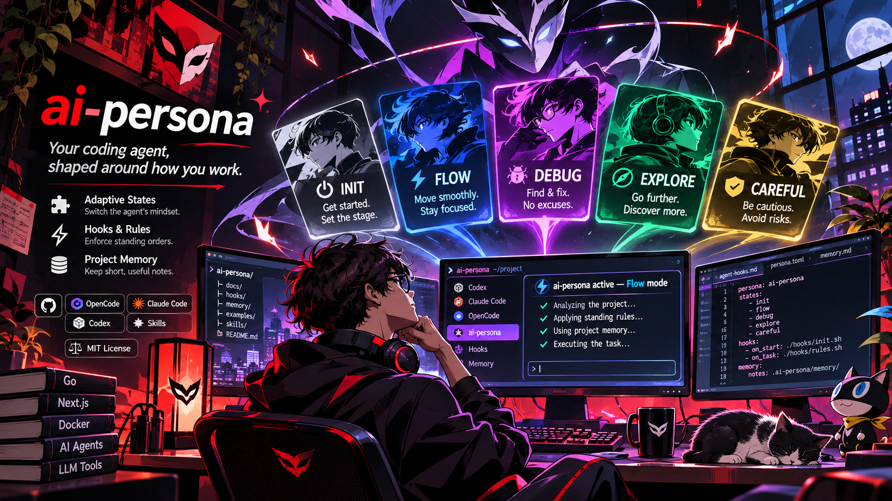
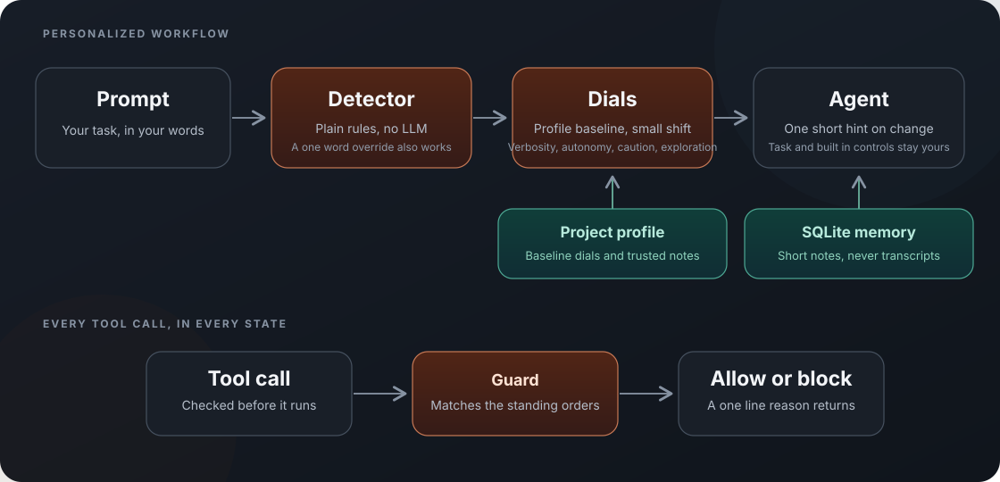

# ai-persona

<p align="center"></p>

<p align="center">
  <a href="https://opencode.ai"></a>
  <a href="https://code.claude.com"></a>
  <a href="https://openai.com/codex"></a>
  <a href="https://skills.sh/aminammar1/ai-persona"></a>
  <a href="LICENSE"></a>
</p>

Your coding agent, shaped around how you work. Five states adapt its style to your project and prompts while keeping your task intact. Hooks enforce standing orders. Memory stores short notes, never transcripts.

## How it works

<p align="center"></p>

The profile sets your baseline. State hints appear only on changes. A one word override works, and built in modes and permissions stay in control. See [agent coverage and hook gaps](docs/agent-hooks.md).

## Real project demo

Same prompt and Go source snapshot in `/home/amine/code-source/bank-api-test`, using OpenCode with the same free model:

> Choose one existing API endpoint in this project. Trace how a request moves through the code and explain what happens, including one edge case. Do not edit any files. Use ai-persona context if it is available, and keep the explanation focused.

| Run | Observed result |
| --- | --- |
| Without ai-persona | Traced `GET /account/{id}` through JWT middleware and PostgreSQL. Chose malformed ID as the edge case and explained its `403` response. No profile context was available. |
| With ai-persona | Called `get_persona`, selected `explore`, and traced the same route. It also surfaced the unchecked JWT claim assertion and the custom expiry claim. No files changed. |

Both answers were correct and asked no follow up questions. This single task shows added project context and exploration, not fewer prompts. In a separate guard check, OpenCode blocked `git push --dry-run /dev/null HEAD` before execution under a temporary `don't push` rule. The test rule was removed afterward.

Codex also traced the endpoint, but its project MCP did not appear in the session. A temporary server test reached the tool, but the session's no approval policy refused the call. Claude's prompt hook returned an `explore` hint, but the requested `ccfree 3` run could not start because its configured model returned a 404. Codex project settings require trust and hook review with `/hooks`; Claude needs an available model in the local setup.

## Install

```bash
npx skills add aminammar1/ai-persona
```

Select all four skills, open your project in the agent, then run `persona-init`. It scans the project, creates `profile.md`, shows the setup plan, and asks before installing hooks and MCP.

| Skill | Use it to |
| --- | --- |
| `persona-init` | Create a profile and configure the current agent |
| `persona-mode` | Show or switch the current state |
| `persona-rules` | Add a standing order in plain language |
| `persona-learn` | Approve or reject a suggested update |

## Contribute

PRs are welcome for a stack template, persona preset, or agent adapter. See [CONTRIBUTING.md](CONTRIBUTING.md).

## License

[MIT](LICENSE) © 2026 Mohamed Amine Ammar.
