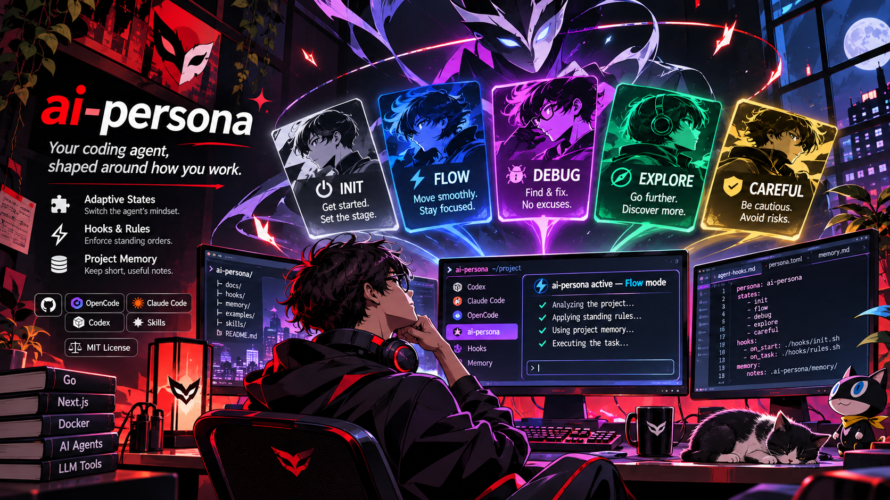
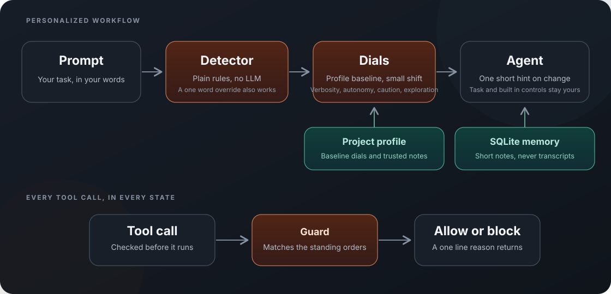

# ai-persona

<p align="center"></p>

<p align="center">
  [](https://m8ven.ai/mcp/aminammar1-ai-persona-1l51uy?s=readme)
  <a href="https://opencode.ai"></a>
  <a href="https://code.claude.com"></a>
  <a href="https://openai.com/codex"></a>
  <a href="https://github.com/can1357/oh-my-pi"></a>
  <a href="https://skills.sh/aminammar1/ai-persona"></a>
  <a href="LICENSE"></a>
</p>

Your coding agent, shaped around how you work. Five states adapt its style to your project and prompts while keeping your task intact. Hooks check tool calls. Memory stores short notes, never transcripts.

## How it works

<p align="center"></p>

The profile sets your baseline. State hints appear only on changes. A one word override works, and built in modes and permissions stay in control. See [agent coverage and hook gaps](docs/agent-hooks.md).

## Demo

Real output from a live OpenCode run in a Go test project, captured with `opencode run`.

**One word changes the state.** A bare `careful` prompt rewrites the stored state:

```json
{
  "lastState": "careful",
  "settingsKey": "{\"verbosity\":\"balanced\",\"autonomy\":\"ask\",\"caution\":\"high\",\"exploration\":\"balanced\"}"
}
```

**Hints ride along invisibly.** The prompt stored in the OpenCode session database keeps your exact text, no persona line appended. The agent still quotes the system note verbatim:

```
Persona flow: verbosity balanced, autonomy act, caution balanced, exploration balanced. act on the task and keep updates brief. Keep the developer's task unchanged; respect active agent modes, tools, and permissions.
```

**Standing orders block tool calls before they run.** After confirming a `don't push` guard, `git push origin main` fails before executing:

```
Error: Blocked by standing order: don't push.
```

**Habits surface as short nudges** at the end of file tool results:

```
Created file successfully: nudge-test.txt
Profile habit (from profile.md): After changing code, run make test before claiming success.
```

And `get_persona` stays compact, 137 characters in this run:

```
Baseline dials: verbosity balanced, autonomy act, caution balanced, exploration balanced. Where we left off: No open problem was recorded.
```

## Install

```bash
npx skills add aminammar1/ai-persona
```

Install all four skills, open your project in the agent, then run `persona-init`. It scans the project, creates `profile.md`, shows the setup plan, and asks before installing hooks and MCP.

## Contribute

PRs are welcome for a stack template, persona preset, or agent adapter. See [CONTRIBUTING.md](CONTRIBUTING.md).

## License

[MIT](LICENSE) © 2026 Mohamed Amine Ammar.
